# Time Tracker

    [](LICENSE) [](https://github.com/skroustalis/timetracker/releases/latest)

A self-hosted time tracker for small teams, written in plain PHP with MariaDB/MySQL. No framework, no build step and no Composer: upload the files to any shared host, open `install.php` in the browser, and you are running.

It was built for a team of about 15 people who log many entries a day, as a free alternative to paid per-seat time-tracking services. The interface is in **Greek and English**, and each user can pick their own theme.

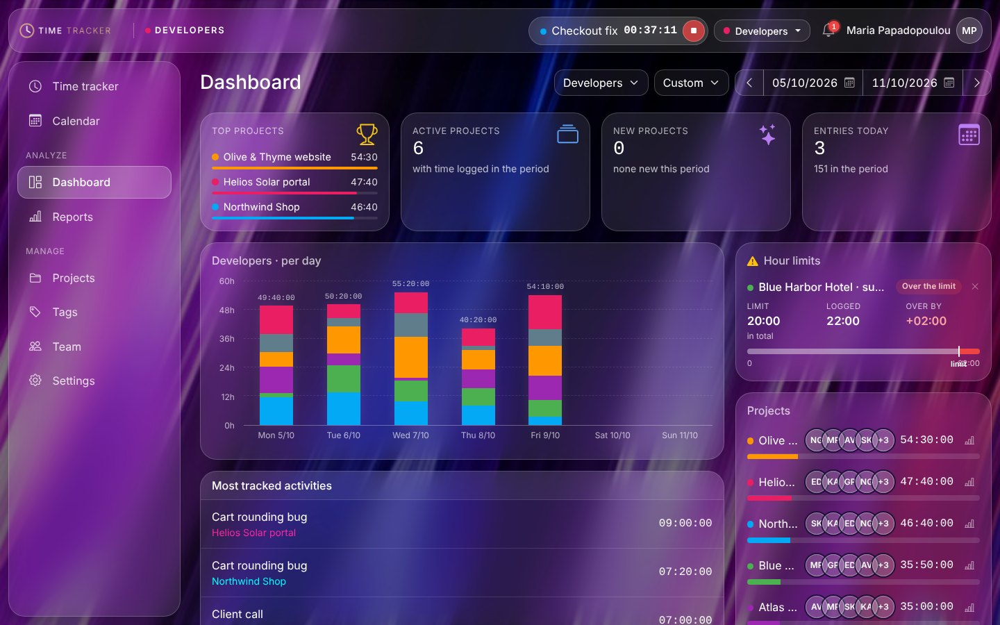

## Features

**Time tracking**
- Start/stop timer or manual entries, each with a description, project, tags and a billable flag.
- Continue, duplicate or edit past entries. Daily and weekly totals.
- Weekly calendar view: click an empty slot to add time, click an entry to change it.
- Forgotten timers stop on their own after a set number of hours (configurable, 0 = never).
- Entries that cross midnight are handled normally.

**Reports**
- Summary with two-level grouping (project, user, group, tag, date or description), a per-day chart and percentages.
- Detailed and weekly views, filters by user, project, tag, billable status and text.
- CSV export (opens in any spreadsheet app) and a print layout.
- All durations shown as `hh:mm` / `hh:mm:ss`, never as decimal hours.

**Projects, tags and hour packages**
- Projects with colour, billable default, archive and a "who worked here" breakdown.
- Hour limits per tag inside a project, e.g. *Northwind Shop · support: 20 hours*. Limits work as **packages**: when one fills up, an admin or manager starts a new one, and any overage carries over. Each package keeps its history.
- Progress bars turn yellow at 80% and red past the limit. Alerts appear on the dashboard, next to the timer and in the notification bell.

**Teams and roles**
- One account per person, with three roles:
  - **Admin**: sees and manages everything, appoints managers.
  - **Manager**: manages the members, projects, tags and time of their own group. A group can have several managers.
  - **Member**: sees and edits only their own time.
- Groups (e.g. *Developers* and *Marketing*) are fully separate: they share no users, projects or tags. The admin switches between them from the top bar.
- New users get an email invitation link to set their own password. Admins and managers can also set a password for them.
- Deactivate accounts without losing their history. The team page shows each person's last sign-in.

**People-friendly by design**
- No money anywhere: no hourly rates or amounts, only hours, billable and non-billable.
- The dashboard does not rank people. Per-person time appears only within a project.

**Look and feel**
- Four themes: *Liquid glass* (18 backgrounds, dark and light), *Classic*, *Neomorphism* and *Minimalism* (10 colour schemes each).
- The admin sets the default look of the app and of the sign-in page separately, uploads a logo and a favicon. Each user can still pick their own.
- Responsive: works on phones as well.
- In-app notifications, optionally also as desktop notifications.

**Under the hood**
- PHP 8.1+, MariaDB 10.x / MySQL 5.7+, Bootstrap 5 and Bootstrap Icons (bundled in `assets/vendor`, no CDN).
- Clean URLs (`/projects` instead of `/projects.php`) through `.htaccess`.
- Database upgrades run automatically: upload the new files and the first page that opens updates the schema.
- Security: prepared statements for all queries with user input, CSRF tokens on forms, `password_hash`, rate-limited sign-in, selector/validator "remember me" tokens, other sessions signed out on password change, `includes/` and uploads locked down with `.htaccess`.
- Tested with 15 users and three years of data (about 175,000 entries): pages open in 30–80 ms, a yearly report in about 0.4 s. Totals are computed in the database, CSV export streams row by row.

## Screenshots

| Time tracker | Calendar |
|---|---|
| 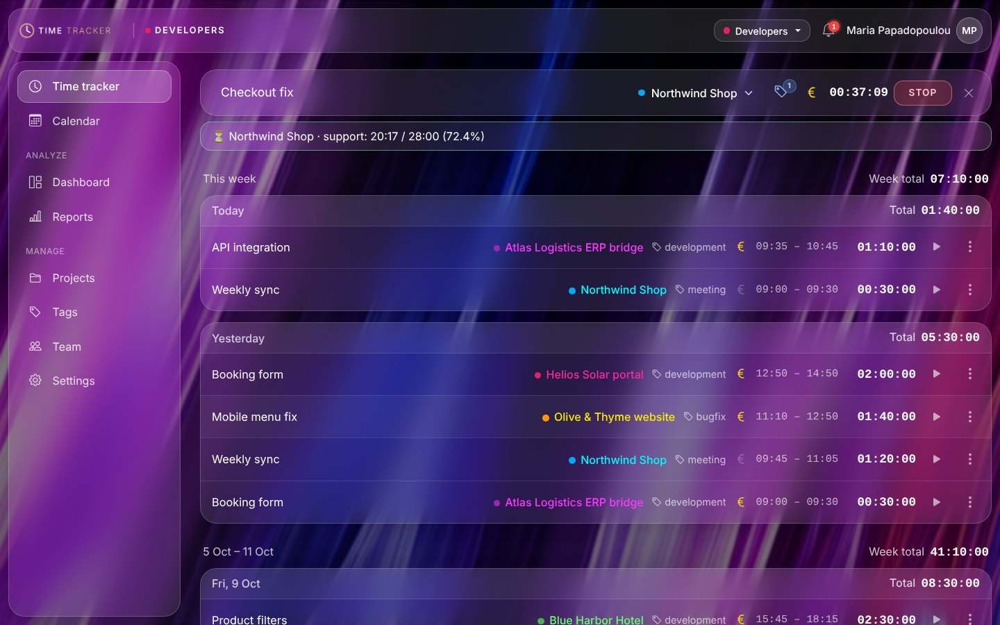 | 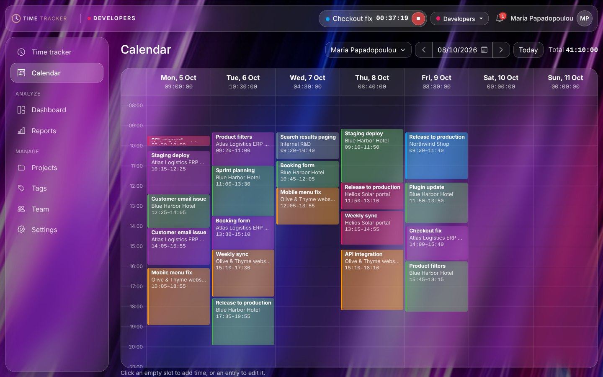 |

| Reports · summary | Reports · detailed |
|---|---|
| 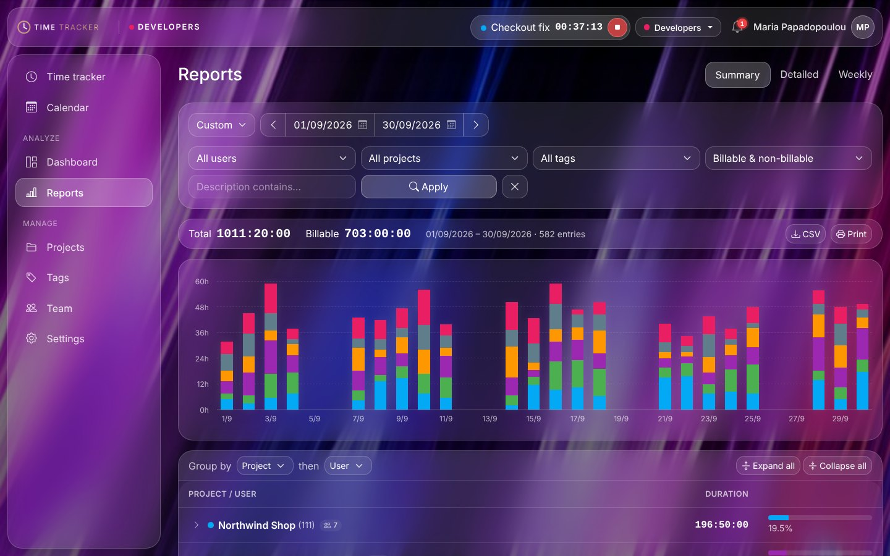 | 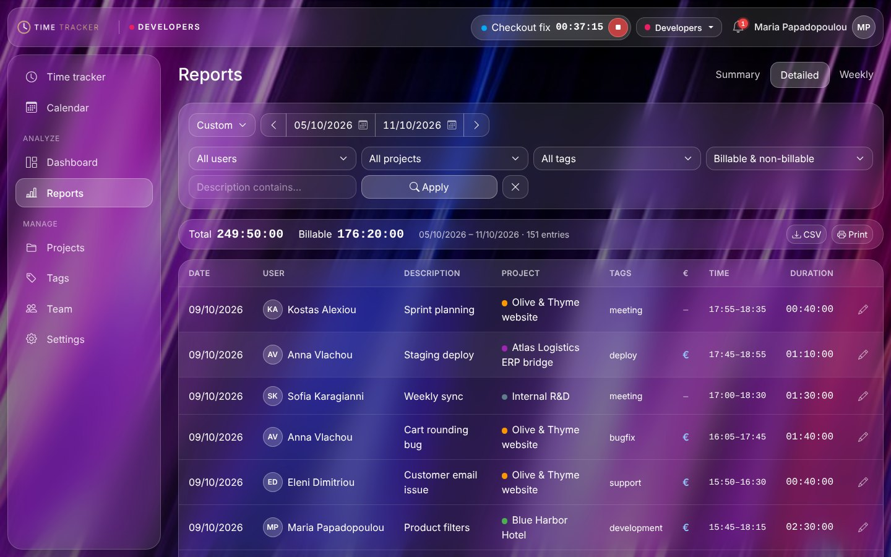 |

| Reports · weekly | Projects |
|---|---|
| 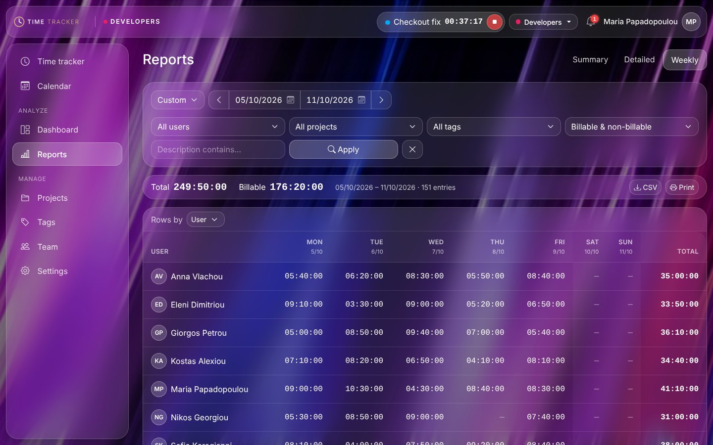 | 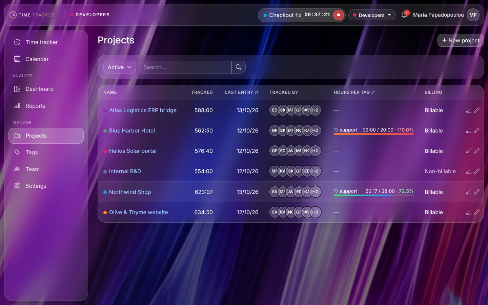 |

| Project with hour packages per tag | Team |
|---|---|
| 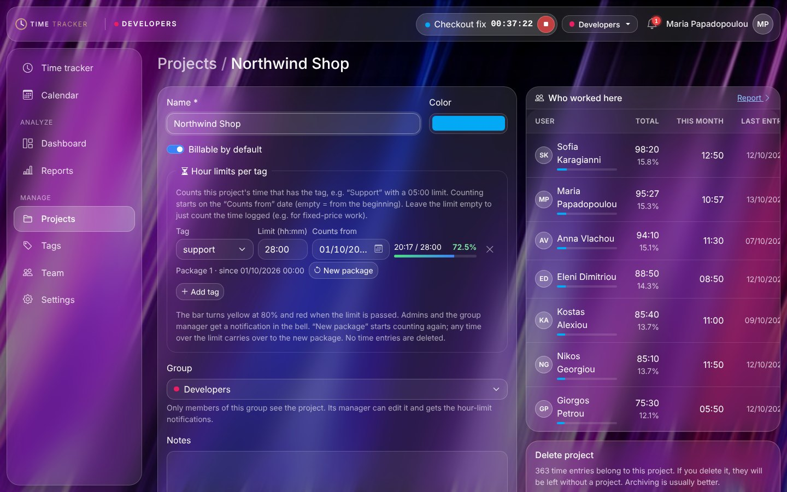 | 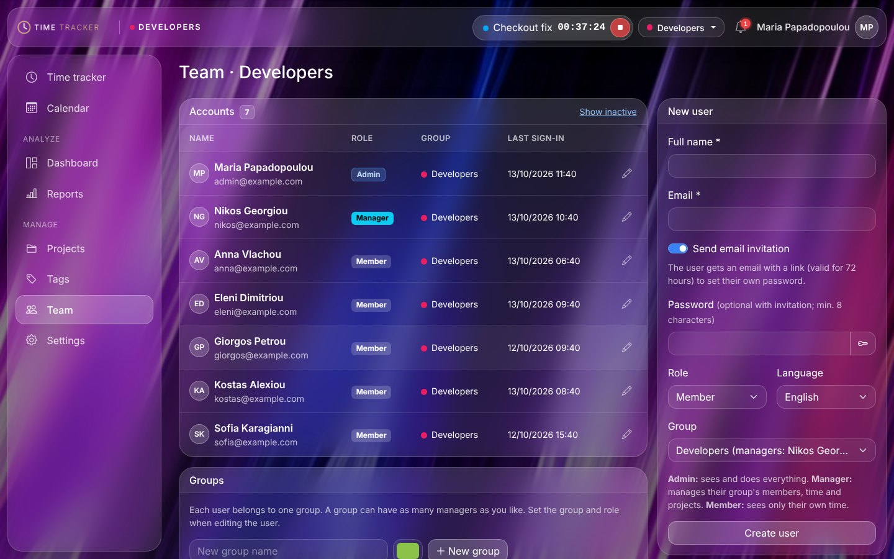 |

| Settings | Sign-in page |
|---|---|
| 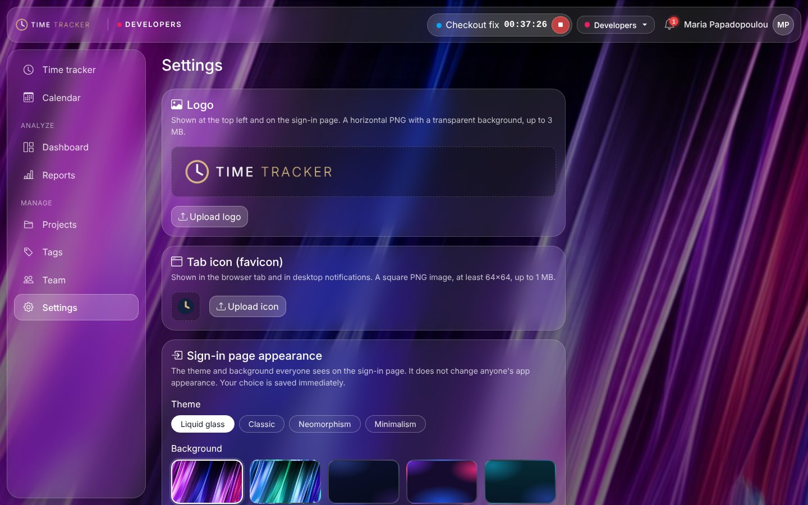 | 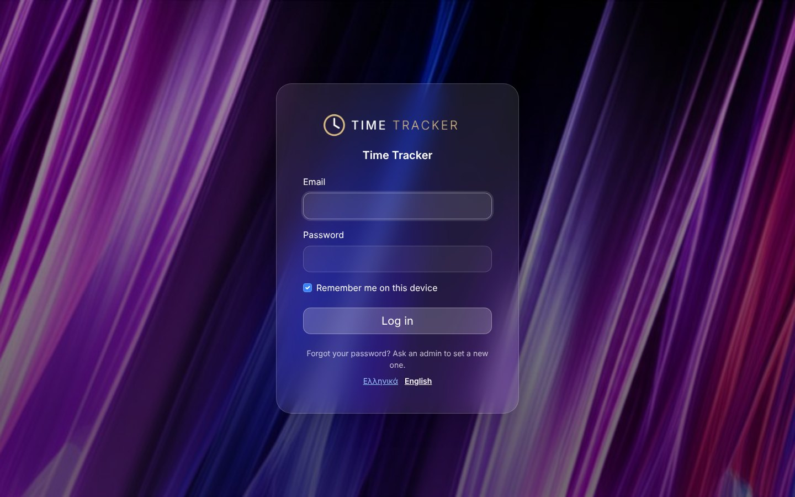 |

**Themes**: Liquid glass dark and light, Neomorphism, Minimalism.

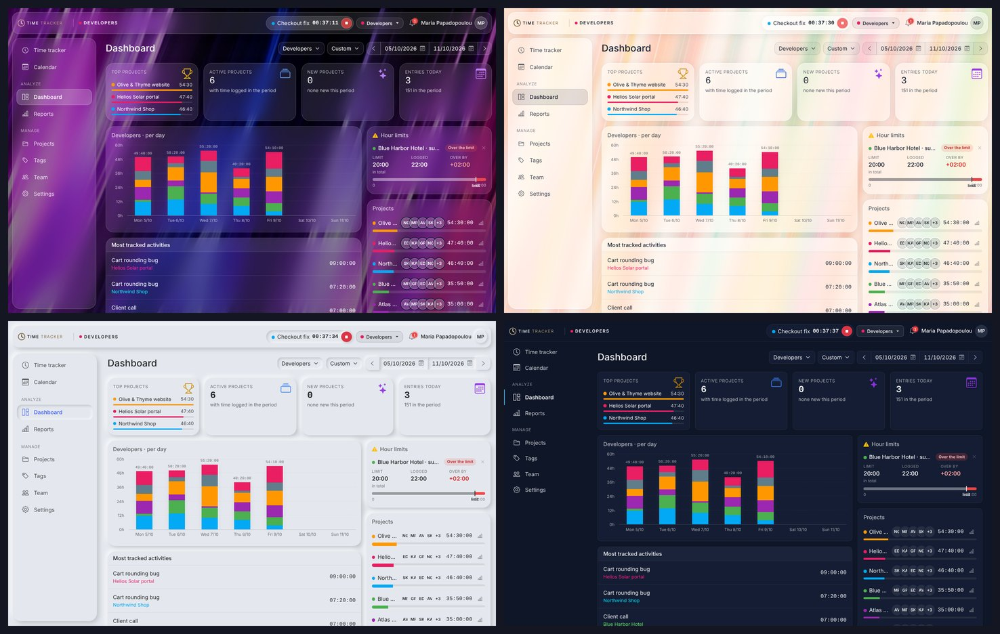

**On a phone**

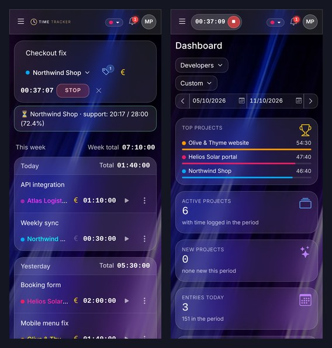

*All names, projects and figures in the screenshots are fictional demo data.*

## Requirements

- PHP 8.1 or newer with the `pdo_mysql`, `mbstring` and `gd` extensions
- MariaDB 10.x or MySQL 5.7+
- Apache with `mod_rewrite` (for clean URLs; LiteSpeed works too)

## Installation (browser only)

Download the latest version from [Releases](https://github.com/skroustalis/timetracker/releases/latest) (or *Code → Download ZIP*).

1. Create an empty database and a database user in your hosting panel.
2. Upload the contents of this repository to a folder on your host (e.g. `public_html/timetracker`) with FTP or the File Manager. The `docs/` folder is not needed on the server.
3. Make sure `includes/` and `uploads/` are writable (755 is usually enough).
4. Open `https://your-domain/timetracker/install.php`. On the first visit it creates an installation key and saves it in **`includes/INSTALL_KEY.txt`**. That file cannot be opened from the browser: read it with FTP or the File Manager.
5. **Step 1:** enter the installation key and the database details. The tables are created and `includes/config.php` is written.
6. **Step 2:** create the first admin account. The installer then locks itself and deletes the key.

The installer is in Greek. After signing in, each user can switch to English from the menu, or set `'default_lang' => 'en'` in `includes/config.php`.

All available settings (database, language, theme, timer auto-stop, email) are listed in `includes/config.example.php`. Add the ones you need to the `includes/config.php` that the installer wrote.

### Email (invitations and password links)

Add the following to `includes/config.php` (see `includes/config.example.php`):

```php
'app_url'   => 'https://timetracker.example.com/',
'mail_from' => 'noreply@example.com',
'smtp' => [
    'host'   => 'mail.example.com',
    'port'   => 465,
    'secure' => 'ssl',   // 'ssl' (465) or 'tls' (587)
    'user'   => 'noreply@example.com',
    'pass'   => '...',
],
```

Without `smtp`, PHP's `mail()` is used.

## Upgrading

Upload the new files over the old ones. `includes/config.php` is never overwritten, and the database is upgraded automatically the next time someone opens a page.

## Project layout

```
├── *.php               pages (tracker, calendar, dashboard, reports, projects, tags, team, settings…)
├── install.php         browser installer
├── schema.sql          database structure for new installs
├── includes/           application code and config (blocked from the browser)
│   ├── bootstrap.php   loaded by every page
│   ├── migrate.php     automatic database upgrades
│   ├── data.php        queries for reports, budgets and packages
│   ├── auth.php        sign-in, roles, groups
│   ├── lang/en.php     English translations (Greek is the source language)
│   └── …
├── assets/             CSS, JS, images, bundled Bootstrap and icons
├── uploads/            profile photos, logo and favicon (scripts cannot run here)
└── docs/screenshots/   images for this README
```

## License

[MIT](LICENSE). Bootstrap and Bootstrap Icons are included under their own MIT licenses.
